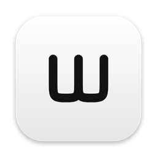
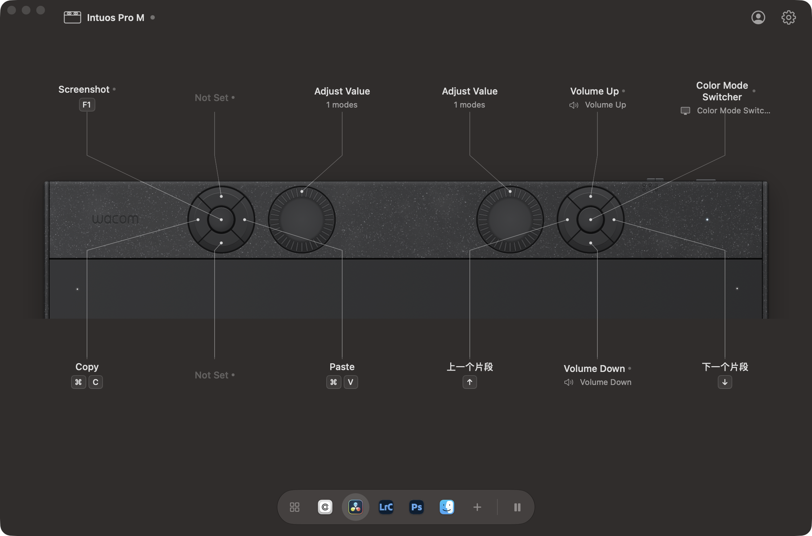
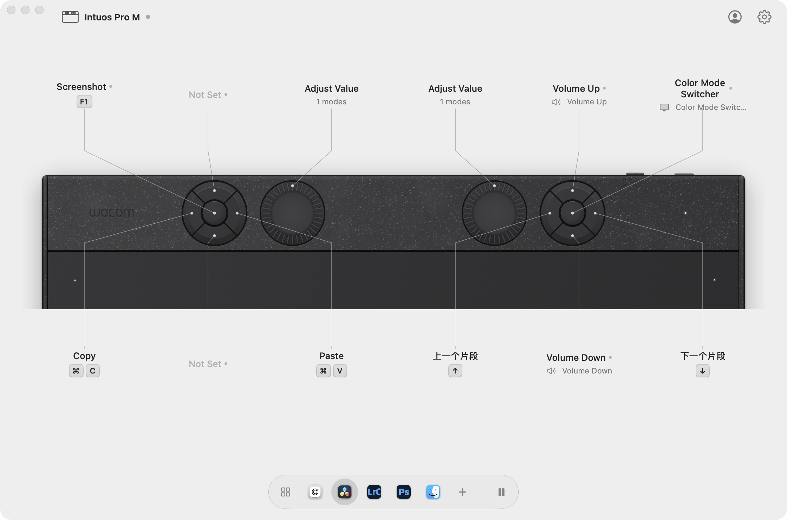

<p align="center">
  
</p>

<h1 align="center">Better Wacom</h1>

<p align="center">
  <b>A faster, nicer way to customize the ExpressKeys and dials on the Wacom Intuos Pro M (2025).</b><br>
  Per-app layouts, long-press actions, smart dials, all in a native macOS app.
</p>

<p align="center">
  <a href="https://github.com/myyccccc/Better-Wacom/releases/latest"></a>
  
  
  <a href="LICENSE"></a>
</p>

<p align="center">
  English · <a href="README.zh-CN.md">简体中文</a>
</p>

> [!IMPORTANT]
> **Built for one tablet only: the Wacom Intuos Pro M (2025), model PTK-670** (USB `056A:03F7`).
> The key layout, the dial behavior and the tablet drawing are all made for this model.
> Other Wacom tablets, including other Intuos Pro sizes and older generations, are **not supported** and probably won't work.

<p align="center">
  
</p>

## Why

The new Intuos Pro M has two key rings and two dials. I wanted them to behave differently in each app I use: Capture One, DaVinci Resolve, Lightroom, Photoshop and Finder. I also wanted long-press actions and dials that feel smooth. The official software couldn't do what I wanted, so I designed my own.

Better Wacom runs **next to** the official Wacom driver. The driver keeps handling the pen (pressure, tilt, mapping). Better Wacom only reads the keys and dials.

## Features

- **See your layout on the real tablet**: a rendered top view of the PTK-670 with every key and dial labeled.
- **Per-app profiles**: layouts switch automatically when you change apps. A *General* profile fills in anything an app profile doesn't set.
- **Click and long press**: each key can have two actions.
- **Smart dials**: multiple modes per dial with acceleration, for example "adjust value", scrolling (with modifier keys), zoom, timeline steps or brush size in Photoshop.
- **Hold-to-choose overlays**: hold a key, turn a dial to pick, release to apply. Use it to switch the display color mode or the sound output device.
- **Action catalog**: keyboard shortcuts, modifiers, scroll, clicks, media keys, fine volume and brightness steps with the native macOS HUD, open an app, or run a shell command (`shortcuts run …` for Shortcuts).
- **Native and light**: SwiftUI, light and dark mode, 15 languages, starts at login, no Dock icon.

<p align="center">
  
</p>

## Install

1. Install the **official Wacom driver** (it is still needed for the pen).
2. In **Wacom Center**, set every ExpressKey and both dials to **Disabled**, so actions don't fire twice.
3. Download `Better-Wacom.zip` from the [latest release](https://github.com/myyccccc/Better-Wacom/releases/latest). It is signed with Developer ID and notarized by Apple. Unzip it and move **Better Wacom** to your Applications folder.
4. Open it and allow **Accessibility** and **Input Monitoring** in *System Settings › Privacy & Security*.

Requires macOS 15 Sequoia or later.

## How it works

- **Reads the tablet without taking it over**: `IOHIDManager` opens the tablet with `kIOHIDOptionsTypeNone`, so the official driver keeps working. Report `0x11` carries the key bitmap and two 7-bit signed dial deltas.
- **Sends actions**: synthesized `CGEvent`s for shortcuts, scrolling and clicks. Media keys go through `NSEvent` system-defined events, so volume and brightness show the native HUD.
- **Profiles**: front-app changes come from `NSWorkspace`. The config is a plain JSON file in `~/Library/Application Support/Better Wacom/config.json`. It is written atomically and reloaded when it changes on disk.

## Build from source

```bash
git clone https://github.com/myyccccc/Better-Wacom.git
cd Better-Wacom
./build.sh        # builds a release, packs ~/Applications/Better Wacom.app and launches it
```

`build.sh` signs with the first *Developer ID Application* certificate in your keychain. If you don't have one, it uses an ad-hoc signature. You can set `SIGN_ID` to choose a certificate.

With an ad-hoc signature, macOS may ask you to allow Accessibility again after each rebuild.

Translations live in `scripts/l10n/*.json`. Run `python3 scripts/gen_strings.py --check` to find missing keys.

## Contributing

Bug reports and pull requests are welcome.

Supporting other tablets would need their HID report layouts and new drawings. If you have another model and want to help, open an issue with the output of `ioreg -p IOUSB -l | grep -i wacom`.

If Better Wacom makes your tablet nicer to use, a ⭐ helps other Intuos Pro owners find it.

## Disclaimer

Better Wacom is an independent project. It is not affiliated with or endorsed by Wacom. "Wacom" and "Intuos" are trademarks of Wacom Co., Ltd.

## License

[MIT](LICENSE)
