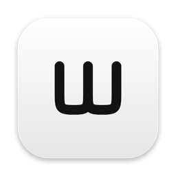
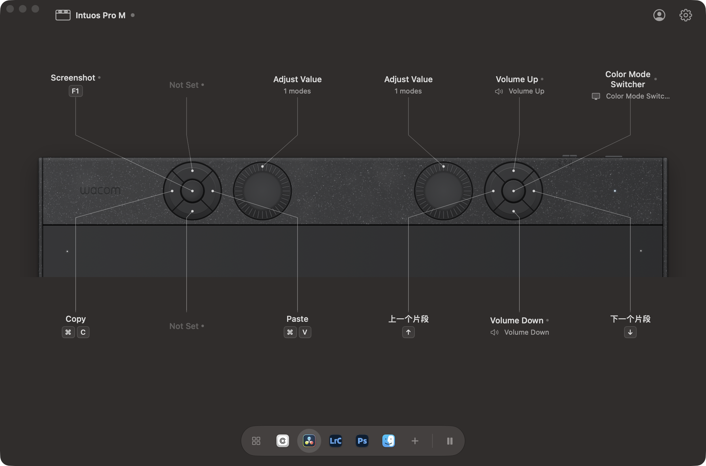

<p align="center">
  
</p>

<h1 align="center">Better Wacom</h1>

<p align="center">
  <b>给 Wacom Intuos Pro M（2025）的快捷键和波轮，换一个更快、更好看的设置工具。</b><br>
  每个 App 一套布局，支持长按，波轮更顺手，原生 macOS 应用。
</p>

<p align="center">
  <a href="https://github.com/myyccccc/Better-Wacom/releases/latest"></a>
  
  
  <a href="LICENSE"></a>
</p>

<p align="center">
  <a href="README.md">English</a> · 简体中文
</p>

> [!IMPORTANT]
> **只适用于一款数位板：Wacom Intuos Pro M（2025），型号 PTK-670**（USB `056A:03F7`）。
> 按键布局、波轮逻辑和数位板渲染图都是按这款机型做的。
> 其他 Wacom 数位板（包括其他尺寸的 Intuos Pro 和旧款）**不支持**，基本无法使用。

<p align="center">
  
</p>

## 为什么做这个

新款 Intuos Pro M 左右各有一个按键环和一个波轮。我想让它们在不同 App 里各干各的活：Capture One、DaVinci Resolve、Lightroom、Photoshop、访达。还想要长按、更顺手的波轮。官方软件做不到我想要的效果，我就自己设计了一个。

Better Wacom 和官方驱动**一起运行**：官方驱动继续管笔（压感、倾斜、映射），Better Wacom 只读取按键和波轮。

## 功能

- **在数位板实物图上看布局**：按 PTK-670 实物绘制的顶视图，每个键、每个波轮都标着当前功能。
- **按 App 自动切换配置**：切换 App 时布局自动跟着换；App 配置里没设置的键，沿用「通用」配置。
- **单击和长按**：每个键可以设置两个动作。
- **波轮多模式**：每个波轮可以有多个模式，带加速。比如调节数值、滚动（可带修饰键）、缩放、时间线逐格，或者在 Photoshop 里调笔刷大小。
- **按住选择浮层**：按住一个键，转波轮选择，松开生效。可以用来切换显示器色彩模式或声音输出设备。
- **动作库**：
  - 快捷键、修饰键、滚动、点击、媒体键；
  - 精细调节音量 / 亮度，会显示系统原生浮层；
  - 打开 App、运行 Shell 命令（可以用 `shortcuts run …` 运行快捷指令）。
- **原生、轻量**：SwiftUI 界面，支持浅色 / 深色，15 种语言，开机自启，没有 Dock 图标。

## 安装

1. 安装 **Wacom 官方驱动**（笔仍然需要它）。
2. 在 **Wacom Center** 里把所有快捷键和两个波轮都设为**禁用**，避免和 Better Wacom 重复触发。
3. 到 [最新版本](https://github.com/myyccccc/Better-Wacom/releases/latest) 下载 `Better-Wacom.zip`。安装包已用 Developer ID 签名，并通过苹果公证。解压后把 **Better Wacom** 拖进「应用程序」。
4. 打开 Better Wacom，在「系统设置 › 隐私与安全性」里允许**辅助功能**和**输入监控**。

需要 macOS 15 Sequoia 或更新版本。

## 实现原理

- **只读、不独占**：用 `IOHIDManager` 以 `kIOHIDOptionsTypeNone` 打开数位板，官方驱动照常工作。报告 `0x11` 里是按键位图，以及两个波轮的 7 位有符号增量。
- **发送动作**：
  - 快捷键、滚动、点击用合成的 `CGEvent` 发送；
  - 媒体键用 `NSEvent` 的 system-defined 事件，所以调音量和亮度时会显示系统原生浮层。
- **配置**：
  - 用 `NSWorkspace` 监听前台 App 的切换；
  - 配置是普通 JSON 文件，位置在 `~/Library/Application Support/Better Wacom/config.json`；
  - 写入是原子操作，文件在外部被修改后会自动重新读入。

## 从源码编译

```bash
git clone https://github.com/myyccccc/Better-Wacom.git
cd Better-Wacom
./build.sh        # 编译正式版，打包到 ~/Applications/Better Wacom.app 并启动
```

`build.sh` 会用钥匙串里第一个「Developer ID Application」证书签名。没有证书时改用本机临时签名，也可以用环境变量 `SIGN_ID` 指定证书。

用临时签名时，每次重新编译后 macOS 可能要求重新授权辅助功能。

翻译在 `scripts/l10n/*.json`，运行 `python3 scripts/gen_strings.py --check` 可以检查缺失的条目。

## 参与

欢迎提交 bug 和 Pull Request。

要支持其他数位板，需要那款机型的 HID 报告格式和新的渲染图。如果你有其他型号并愿意帮忙，请开一个 Issue，附上 `ioreg -p IOUSB -l | grep -i wacom` 的输出。

如果 Better Wacom 让你的数位板更好用，点个 ⭐ 能让更多 Intuos Pro 用户看到它。

## 声明

Better Wacom 是独立项目，和 Wacom 公司没有关联，也没有得到其认可。「Wacom」和「Intuos」是 Wacom Co., Ltd. 的商标。

## 许可

[MIT](LICENSE)
